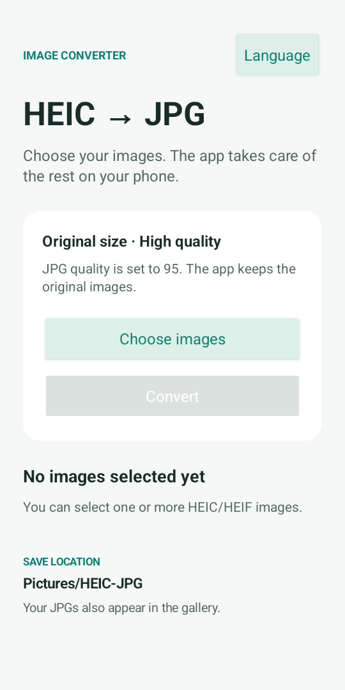

# HEIC → JPG for Android

Convert HEIC and HEIF photos to JPG on your phone. The app is simple, ad-free,
and works offline. Your original photos stay as they are.

## Download

**[Download the V1.0.1 APK](https://github.com/huser123/HEIC-to-JPG-Android-app/releases/download/V1.0.1/HEIC-JPG-1.0.1.apk)**

Requires Android 10 or later. If Android asks, allow your browser or file
manager to install the APK.

**If you have V1.0.0 installed, uninstall it before installing V1.0.1.**
V1.0.1 uses a new signing key.

[Release notes and checksum](https://github.com/huser123/HEIC-to-JPG-Android-app/releases/tag/V1.0.1) · [APK in the repository](RELEASE/V1.0.1/HEIC-JPG-1.0.1.apk?raw=true)



## How to convert photos

1. Open **HEIC → JPG** and tap **Choose images**. To select more than one photo,
   touch and hold the first one in the Android file picker.
2. Tap **Convert** and keep the app open until it finishes.
3. Find your JPGs in the gallery or in **Pictures/HEIC-JPG** on your phone.
   A Hungarian file manager may show the Pictures folder as **Képek**.

Tap **Language** or **Nyelv** to switch between **English** and **Magyar**. The
app remembers your choice. On first launch it uses Hungarian if that is your
phone's primary language, and English otherwise.

## What to expect

- The app keeps the original dimensions and uses JPEG quality 95. It skips
  metadata such as GPS location, camera model, and the original capture date.
- Everything is converted on your phone. There are no ads, accounts, or
  analytics. The Android file picker gives the app access to the files you
  choose. A cloud provider may still need a connection to download a photo.
- If a file fails, the app reports the problem and continues with the rest.
  If a JPG already has the same name, the app adds a number to the new one.

<details>
<summary>Technical details and build instructions</summary>

### Conversion details

The app uses Android's ImageDecoder to apply rotation and mirroring. It writes
lossy 8-bit sRGB JPGs and fills transparent pixels with white. For HEIF files
with multiple images, it exports the primary still image and skips motion
data, depth maps, and other auxiliary data.

The app keeps the screen on during conversion, and a batch survives screen
rotation. Conversion ends if you force-stop the app or Android ends its
process. Selecting new files releases any persistent read permissions granted
for the previous selection.

### Open and build the source

Open this folder in Android Studio. You need the following tools.

- JDK 17
- Android SDK Platform 35
- Android SDK Build Tools 35.0.0
- Gradle 8.10.2 (the included wrapper downloads it automatically)

Set the SDK path in Android Studio or in your own `local.properties` file
with `sdk.dir=/path/to/android/sdk`.

On Linux or macOS, run:

```sh
./gradlew assembleRelease
```

On Windows, run:

```bat
gradlew.bat assembleRelease
```

With signing configured as described below, Gradle writes an installable APK
to `app/build/outputs/apk/release/app-release.apk`. Without signing configured,
Gradle produces `app-release-unsigned.apk`, which Android cannot install directly.

For a quick test, run `./gradlew assembleDebug` (or
`gradlew.bat assembleDebug` on Windows). Gradle automatically signs the debug APK
at `app/build/outputs/apk/debug/app-debug.apk`.

The first build needs internet access to download Android and Kotlin
dependencies. The installed app works offline.

### Signing and future updates

The public repository excludes the private signing key and password file.

1. Copy `signing/release.properties.example` to `signing/release.properties`
   and fill in your values.
2. Place the key at the path in the configuration. The path is relative
   to the project root.
3. Run `assembleRelease` as shown above.

To create your own key, run the JDK's `keytool`. It prompts you for the
password and certificate details.

```sh
keytool -genkeypair -keystore signing/heic-jpg.jks -alias heic-jpg -keyalg RSA -keysize 3072 -validity 10000
```

To update an existing installation, use the signing key from that installation
and a higher `versionCode`. Use the V1.0.1 signing key for future updates to
V1.0.1 installations.

The `.gitignore` excludes signing keys and the password file. Store them
in a secure, private place.

### Tests

The tests in `app/src/androidTest` run on an Android device or emulator with
real HEIC fixtures. They exercise Android's decoder and MediaStore directly.

```sh
./gradlew connectedDebugAndroidTest
./gradlew lint
```

The tests check the JPEG signature, dimensions, colors, 90-degree rotation,
original file preservation, published MediaStore entries, naming collisions,
rejection of corrupt files and unsupported formats, and batch processing after
a corrupt image.

### Project structure

- `MainActivity.kt` provides the single-screen English and Hungarian interface,
  the language selector, and access to the system file picker.
- `Converter.kt` handles HEIF decoding, JPEG encoding, and safe MediaStore writes.
- `ConverterApplication.kt` processes files sequentially and retains state across
  screen rotations.

The app's only external runtime dependency is the Kotlin standard library.
It targets direct APK installation on Android 10 or later.

</details>
